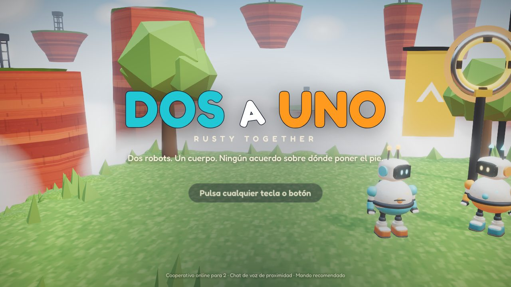
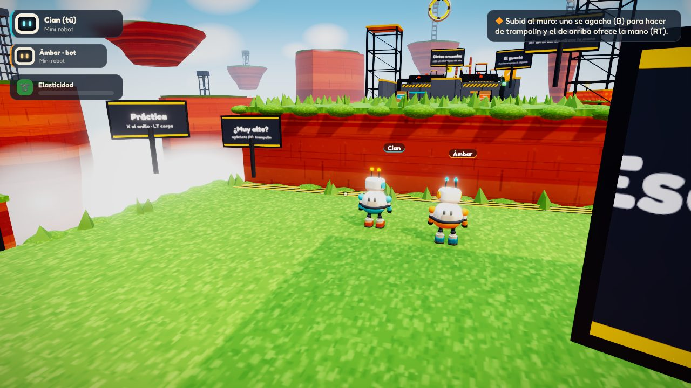
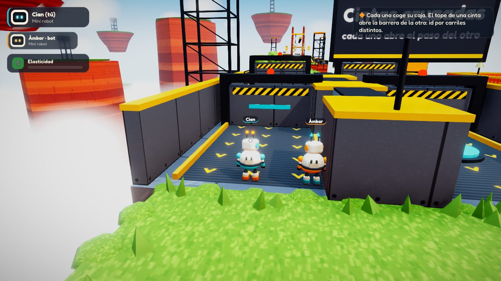
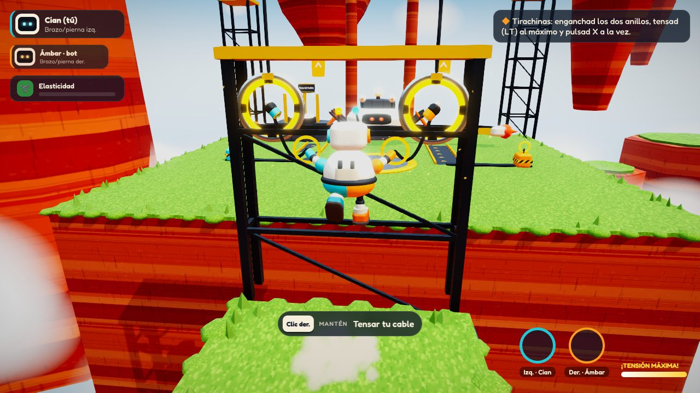
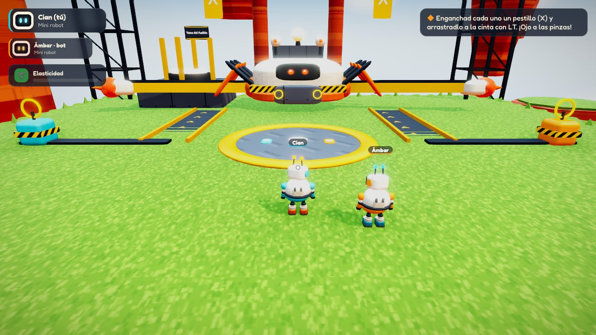

# Dos a Uno · Rusty Together

> **Dos robots. Un cuerpo. Ningún acuerdo sobre dónde poner el pie.**

Muestra vertical (*vertical slice*) del documento de diseño [`docs/GDD.md`](docs/GDD.md): plataformas 3D cooperativas para dos. Cada jugador controla su mini robot y, en ciertas zonas, los dos se acoplan en un único cuerpo de 2,2 m en el que cada persona mueve **una pierna y un brazo**.



| | |
|---|---|
|  |  |
|  |  |

## Qué incluye

- **Tutorial para un jugador, «Taller de pruebas».** Enseña cada verbo de uno en uno: moverse, salto variable, cajas, puño cableado, balanceo y muelle. Después aparece **Ámbar-bot**, un compañero IA hecho con Yuka, y con él se aprenden el trampolín, la mano ofrecida, el rescate en el aire, el acoplamiento, el salto unilateral frente al conjunto, el tirachinas y la separación.
- **Nivel 1 cooperativo online, «Muelles de rebote».** Tiene las seis salas del GDD:
  1. **Escuela de guantes** (separados): un muro de 2,4 m que se supera con trampolín y mano ofrecida, y un hueco con un anillo alto que solo se alcanza desde el trampolín del compañero. El primero que cruza ofrece la mano al segundo.
  2. **Cintas cruzadas** (separados): dos cintas a contracorriente y una caja con el nombre de cada uno. El tope de una cinta abre la barrera de la otra (relevo) y hay una única «carga rápida» que te ayuda a ti y acelera la cinta del compañero durante 5 s.
  3. **Carrera de muelles** (opcional): arena de un minuto con doble consentimiento, dos rondas de 20 s, campanas propias, empujones con el puño, empate permitido y una pegatina de sesión para quien gane.
  4. **Primer cuerpo** (unidos): placa de acoplamiento con consentimiento doble de 0,6 s. La dirección del cuerpo es la media de las dos piernas. Primero un bote unilateral y después saltos conjuntos (ventana de 250 ms).
  5. **Pasamanos de grúas** (unidos): un balancín físico, anillos alternos con brazos telescópicos de 8 m y un tirachinas de 6 m con doble confirmación en 350 ms.
  6. **Cangrejo clasificador** (clímax con las dos formas):
     - **A:** cada mini engancha un pestillo y lo arrastra a la cinta, esquivando barridos avisados con 1 s de antelación.
     - **B:** unidos, agarran las asas; uno ancla mientras el otro tira, y luego intercambian los papeles para extraer el fusible.
     - **C:** esquivan el barrido bajo con un salto conjunto y llevan el fusible a la toma.
- **Online con salas privadas.** El anfitrión crea una sala y recibe un **código de 5 caracteres**; el invitado se une con ese código. Hay lobby con colores intercambiables, «listo», reconexión (90 s para el invitado) y pausa compartida.
- **Chat de voz por proximidad** (WebRTC). La voz del compañero sale de su robot, con panorámica HRTF, y se atenúa con la distancia entre los robots: volumen pleno a menos de 7 m y casi silencio a 32 m. Se puede silenciar (M) o usar «pulsar para hablar» (V). Ningún obstáculo exige hablar.
- **Física real con Rapier.** Los robots son cápsulas dinámicas con un controlador propio, que incluye coyote time, búfer de salto, salto variable y gravedad asimétrica. Las cuerdas tienen péndulo real; las cajas, el balancín y el peso de los robots son físicos.
- **Acabado:**
  - Robots procedurales fieles al concept, con visor de ojos expresivos, antenas con muelle, squash and stretch y gestos.
  - Partículas con three.quarks y postprocesado: AO, bloom, ACES y viñeta.
  - Audio 100 % sintetizado y música adaptativa por capas.
  - HUD contextual que muestra las teclas o botones del dispositivo que estés usando, flecha hacia el compañero, medallas y estadísticas.
- **Accesibilidad:** modo ayuda (ventanas de 450 ms y agarres más anchos), reducción de sacudidas y destellos, agarre alterno, inversión del eje Y y sensibilidad. La identidad de cada robot no depende solo del color: Cian lleva planeta y antenas redondas, y Ámbar estrella y antenas cónicas.

## Cómo jugar

```bash
npm install
npm run dev          # cliente Vite (http://localhost:5173) + servidor Colyseus (:2567)
```

- **Un jugador:** *Tutorial: Taller de pruebas*.
- **Dos jugadores en la misma red:** uno pulsa *Crear sala*, comparte el código y el otro entra en `http://IP-del-anfitrión:5173` → *Unirse con código*.
- **Por Internet:** despliega la versión de producción (abajo) en un servidor accesible y abrid los dos la misma URL.

### Controles

| Mando | Teclado / ratón | Mini robot | Cuerpo unido |
|---|---|---|---|
| Stick izq. | WASD | Moverse | Dirigir **tu** pierna |
| Stick der. | Ratón | Cámara | Apuntar **tu** brazo |
| A | Espacio | Saltar (mantén = más alto) | Impulso de tu pierna (dos a la vez = salto conjunto) |
| B | Shift | Agacharse · hacer de trampolín | Anclar tu pierna (pivote) |
| RT | E | Agarrar · ofrecer la mano · coger cajas | Agarrar asas con tu mano |
| X | Clic izq. / F | Puño cableado (4 m) | Brazo telescópico (8 m) · tirachinas |
| LT | Clic der. / Q | Recoger cable · cargar muelle | Tensar tu cable |
| Y (mantener) | R | Acoplarse en una placa | Separarse |
| RB | G | Señalar un punto | Señalar |
| Cruceta | 1-4 | Gestos | Gestos |
| — | V / M | Pulsar para hablar / silenciar | |

### Móvil y tableta

Se juega en horizontal. Al primer toque el juego pasa a pantalla completa y bloquea la orientación cuando el navegador lo permite.

- **Pulgar izquierdo:** stick flotante. Aparece donde apoyas el dedo y se arrastra contigo si te pasas del borde, así que nunca hay que volver al centro.
- **Pulgar derecho:** arrastra en cualquier zona libre para mover la cámara. Unidos, ese arrastre apunta tu brazo.
- **Botones en arco alrededor de *Saltar*:** Puño, Tensar y Agarrar en el primer anillo; Agachar y Unir, más pequeños, en el segundo. Al deslizar el dedo de un botón a otro, la pulsación pasa al nuevo botón: de *Saltar* a *Agarrar* para coger la mano en el aire. Si lo deslizas fuera de los botones, el botón sigue pulsado y además mueves la cámara.
- Los botones que pide el juego parpadean. Los textos de objetivo cambian «RT», «X»… por los iconos de pantalla.
- Hay vibración háptica. En *Ajustes → Pantalla táctil* se cambian la sensibilidad, el tamaño de los botones y la vibración.
- Arriba a la derecha están el micro (online), la señal, los gestos y la pausa.

## Producción y despliegue

```bash
npm run build        # typecheck + bundle en dist/ + precompresión brotli/gzip
PORT=8080 npm start  # un único proceso: Colyseus + estáticos de dist/
```

El servidor entrega los `.br`/`.gz` generados al compilar: el bundle baja de 4,5 MB a 1,2 MB. Los assets con hash se cachean un año y `index.html` se revalida siempre.

### Docker / Sliplane

```bash
docker build -t rusty-together .
docker run -p 8080:8080 rusty-together   # http://localhost:8080
```

La imagen es multi-etapa sobre `node:22-alpine`. Ejecuta el servidor TypeScript directamente (Node 22 elimina los tipos), corre como usuario sin privilegios e incluye `HEALTHCHECK` contra `/health`.

Para desplegar en [Sliplane](https://sliplane.io):

1. Crea un servicio desde el repositorio de GitHub. *Dockerfile path*: `Dockerfile` (raíz).
2. **Puerto expuesto:** `8080`. La imagen ya define `PORT=8080`; si el servicio define otro `PORT`, el servidor lo respeta.
3. **Health check:** `/health` (responde `{"ok":true}`).
4. Opcional: `VITE_TURN_URL`, `VITE_TURN_USER` y `VITE_TURN_PASS` para la voz detrás de NAT estrictos. Son argumentos de *build* (`ARG` en el Dockerfile), porque Vite los incrusta en el cliente al compilar.
5. Despliega. El cliente se conecta por WebSocket al mismo origen (HTTPS → `wss://`), así que no hace falta configurar ninguna URL.

El estado de las salas vive en memoria. Usa **una sola instancia**: no escales horizontalmente sin añadir un presence/driver compartido de Colyseus (Redis).

En producción, el cliente se conecta al mismo origen. Si sirves el cliente por separado, define `VITE_SERVER_URL`.

Para la voz detrás de NAT estrictos, añade un servidor TURN propio con `VITE_TURN_URL`, `VITE_TURN_USER` y `VITE_TURN_PASS`. Por defecto solo se usa STUN público, que basta en la mayoría de redes domésticas.

## Arquitectura

```
server/           Colyseus 0.18: sala privada con código, lobby (schema), relé y señalización WebRTC
shared/protocol   Contrato cliente/servidor (códigos de sala…)
src/core          Entrada (teclado/ratón/mando con latch de pulsaciones), audio procedural, ajustes
src/net           Sesión online/offline, reloj compartido (estilo NTP), voz por proximidad
src/game          Simulación, controladores de robots, replicación, cámara, HUD, niveles
src/ui            Menús, lobby, HUD, pausa, ajustes
tests/            Vitest (lógica pura e invariantes de tuning del GDD)
.claude/skills    Skills de gamedev (three.js, game feel, cámara, plataformas…) para agentes
```

### Rendimiento

- **Niveles de calidad** *alta / media / baja*. En modo automático se elige uno según el dispositivo (los móviles empiezan en baja). Un `PerformanceMonitor` baja de nivel en caliente si no se mantienen los FPS.
  - **Baja:** sin sombras dinámicas (se usan sombras de mancha), sin postproceso, DPR reducido y menos nubes y partículas.
  - **Media:** bloom, ACES y SMAA.
  - **Alta:** añade N8AO, gradación y viñeta.
- **Batching estático:** al cargar el nivel, todo el escenario marcado como estático se fusiona por material y por celda de 80 m, sin perder el frustum culling.
- **Rig merging:** las piezas de cada robot, caja o cangrejo que se mueven juntas se fusionan en una malla con color por vértice.
- **Resultado:** de unas 830 a unas 430 draw calls en alta y unas 320 en baja.

### Modelo de red

Sigue el GDD: el anfitrión valida y el invitado envía intenciones.

- **Minis:** cada jugador simula su propio mini robot, con respuesta inmediata, y envía su pose a 30 Hz. El robot del compañero es un proxy cinemático interpolado con un búfer de jitter adaptativo. El retardo se ajusta solo a la latencia y la variación reales de cada conexión (30–350 ms) y extrapola hasta 150 ms si falta un paquete. Eso permite subirse a su cabeza (trampolín), agarrar su mano o empujarlo.
- **Mundo compartido:** el anfitrión simula todo lo compartido (cuerpo unido, cajas, balancín, cangrejo, arena, puertas) y envía instantáneas a 30 Hz con variables replicadas por diferencias. La primera instantánea es completa, para que el invitado vea el mundo correcto desde el primer frame.
- **Cuerpo unido:** el invitado envía su pierna, su brazo y sus pulsaciones con marca de tiempo del reloj del anfitrión. El salto conjunto empieza como bote inmediato y se «mejora» si la otra pulsación cae dentro de la ventana. Así nadie siente retraso y la ventana no favorece al anfitrión.
- **Reloj compartido:** los dos clientes se sincronizan con el reloj del *servidor* al estilo NTP: se queda la muestra de menor RTT y los ajustes posteriores son graduales. Empieza con una ráfaga de pings en el lobby, así que al empezar el nivel ya ha convergido y no depende del hilo principal del otro jugador.
- **Conexión a la primera:** crear la sala o unirse a ella se reintenta solo ante fallos transitorios (tres intentos con espera).

## Librerías

| Herramienta | Uso |
|---|---|
| [React Three Fiber](https://github.com/pmndrs/react-three-fiber) + [Drei](https://github.com/pmndrs/drei) | Escena, `Environment`/`Lightformer` (IBL sin descargas), `Html` para etiquetas, `AdaptiveDpr` |
| [React Three Rapier](https://github.com/pmndrs/react-three-rapier) | Motor de físicas: cápsulas de los robots, colisionadores, balancín dinámico, raycasts |
| [Yuka](https://github.com/Mugen87/yuka) | Ámbar-bot (`Vehicle` + `ArriveBehavior` + `StateMachine`) y el autómata del cangrejo |
| [three.quarks](https://github.com/Alchemist0823/three.quarks) | Polvo, chispas, confeti, estrellas y la explosión de acoplamiento (pools sin asignaciones en juego) |
| [React Postprocessing](https://github.com/pmndrs/react-postprocessing) | N8AO, bloom, ACES, SMAA, viñeta y gradación |
| [Colyseus](https://github.com/colyseus/colyseus) | Salas privadas, lobby con schema, reconexión y plugin de señalización WebRTC |
| [gamedev-skills](https://github.com/gamedev-skills/awesome-gamedev-agent-skills) | Skills incluidas en `.claude/skills` (Apache-2.0) para seguir desarrollando con agentes |
| TripoSR | **No se usa en esta muestra.** Todo el arte es procedural (robots, cangrejo, escenario, texturas), así que el build no depende de assets ni de GPU. TripoSR encaja en el siguiente paso: convertir el concept en modelos GLB que sustituyan a `RobotModel` manteniendo el rig por grupos. |

## Comprobaciones

```bash
npm run typecheck
npm test
```

Además, durante el desarrollo se jugó la partida en Chromium sin interfaz con dos clientes reales (anfitrión e invitado). Se verificaron:

- La sala por código, el lobby y la voz WebRTC conectada.
- La pose replicada en ambos sentidos.
- El rescate con la mano entre clientes y el transporte de cajas por el invitado.
- El acoplamiento online, la pierna única, las dos piernas y el salto conjunto.
- Todas las mecánicas del tutorial y del cangrejo (fases A, B y C) hasta la pantalla final.

## Créditos

Diseño: `docs/GDD.md`. Referencia visual: `docs/concept/robot01.jpg`.
